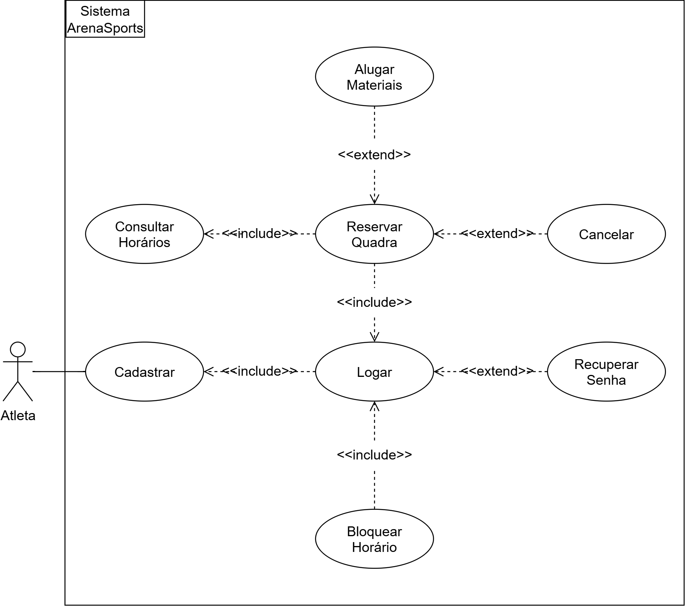

# ArenaSports — Documentação de Software

**Disciplina:** Engenharia de Requisitos

**Instituição:** Universidade Federal do Amazonas (UFAM) — Instituto de Ciências Exatas e Tecnologia (ICET)  

---

## 1. Introdução

### 1.1. Descrição Geral do Software
O sistema **ArenaSports** é uma plataforma voltada à automação e gestão de agendamentos de quadras esportivas (society, areia e poliesportivas). O sistema resolve o problema do choque de horários e da informalidade em reservas, permitindo que atletas visualizem agendas em tempo real, realizem reservas via PIX e que os administradores controlem o caixa e bloqueiem horários para manutenção. 

### 1.2. Descrição dos Usuários
Os usuários desse sistema podem ser classificados em:

1. **Atleta / Cliente:** Atletas locais que desejam consultar horários disponíveis, realizar reservas de quadras e contratar materiais adicionais (coletes, bolas)

2. **Atendente / Administrador:** Responsável por gerenciar as quadras, validar reservas efetuadas presencialmente/balcão, bloquear horários para manutenção e emitir relatórios de faturamento. 

---

## 2. Requisitos Gerais do Software

### 2.1. Requisitos Funcionais

| Identificador | Descrição | Escopo | Prioridade |
| :--- | :--- | :--- | :--- |
| **RF01** | O sistema deve permitir que o usuário crie um cadastro informando nome, e-mail, telefone e senha. | Geral | Essencial |
| **RF02** | O sistema deve permitir o acesso do usuário por meio de login com e-mail e senha. | Geral | Essencial |
| **RF03** | O sistema deve exibir a grade de horários disponíveis e ocupados por data e quadra. | Agendamento | Essencial |
| **RF04** | O sistema deve permitir a reserva de um horário mediante confirmação de pagamento do sinal. | Agendamento | Essencial |
| **RF05** | O sistema deve permitir que o usuário inclua aluguel de materiais adicionais (coletes, bolas) na reserva. | Agendamento | Desejável |
| **RF06** | O sistema deve permitir que o usuário solicite o cancelamento de uma reserva realizada. | Agendamento | Importante |
| **RF07** | O sistema deve permitir que o administrador bloqueie horários da agenda para manutenção. | Administração | Importante |
| **RF08** | O sistema deve permitir a saída do usuário (logout). | Geral | Importante |

### 2.2. Requisitos Não Funcionais

| Identificador | Descrição | Categoria | Escopo | Prioridade |
| :--- | :--- | :--- | :--- | :--- |
| **RNF01** | O sistema deve criptografar todas as senhas dos usuários. | Segurança | Geral | Essencial |
| **RNF02** | O sistema deve processar as consultas de disponibilidade e respostas da agenda em até 2 segundos. | Desempenho | Agendamento | Importante |
| **RNF03** | O sistema deve disponibilizar interface totalmente responsiva para navegação em dispositivos móveis. | Usabilidade | Geral | Essencial |
| **RNF04** | O sistema deve oferecer tema escuro opcional para melhor experiência do usuário. | Usabilidade | Geral | Desejável |

### 2.3. Regras de Negócio

| Identificador | Descrição | Escopo | Prioridade |
| :--- | :--- | :--- | :--- |
| **RN01** | A reserva online de uma quadra só é confirmada mediante o pagamento prévio de no mínimo 50% do valor do horário. | Agendamento | Essencial |
| **RN02** | Cancelamentos de reservas com direito a reembolso ou crédito só podem ser efetuados com até 6 horas de antecedência do horário agendado. | Agendamento | Importante |
| **RN03** | O mesmo horário de uma quadra não pode ser reservado por dois clientes simultaneamente. | Agendamento | Essencial |
| **RN04** | O horário selecionado fica pré-reservado por 10 minutos; caso o pagamento não seja concluído nesse período, a vaga é liberada automaticamente para a agenda. | Agendamento | Importante |
| **RN05** | Clientes que realizarem mais de 5 reservas no mesmo mês recebem 10% de desconto no valor do próximo agendamento. | Financeiro | Desejável |

---

## 3. Diagramas UML

### 3.1. Diagramas de Casos de Uso

### 3.2. Diagramas de Sequência

### 3.3. Diagramas de Atividades
